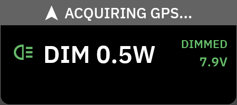
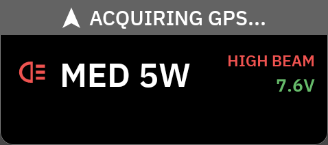
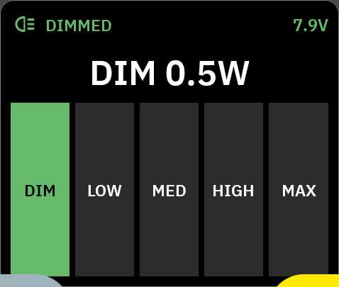
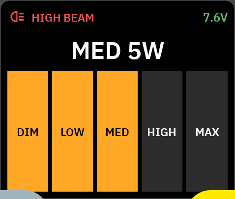
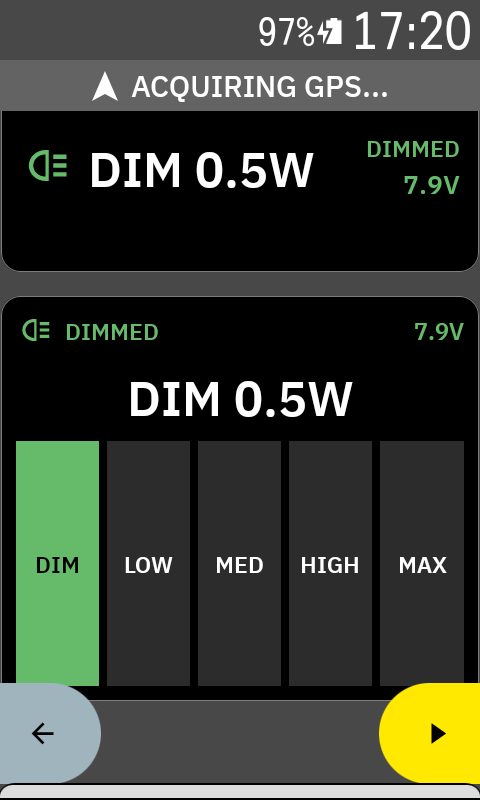
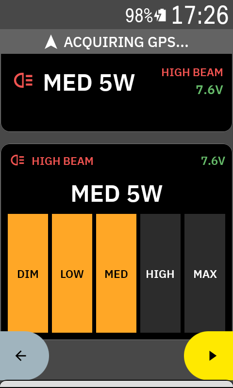
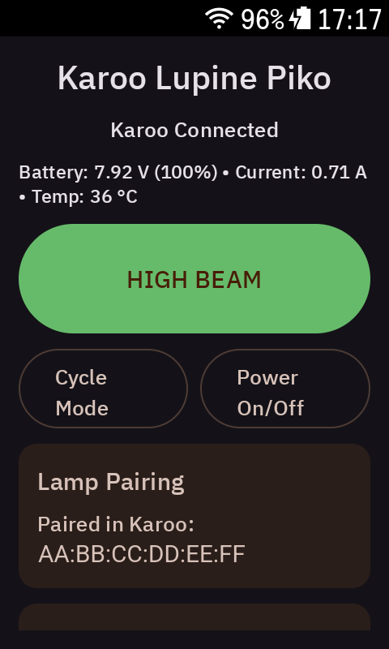
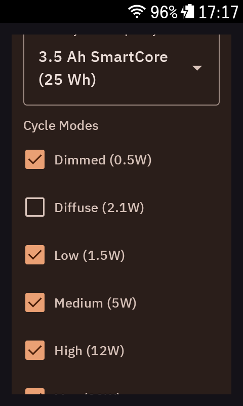
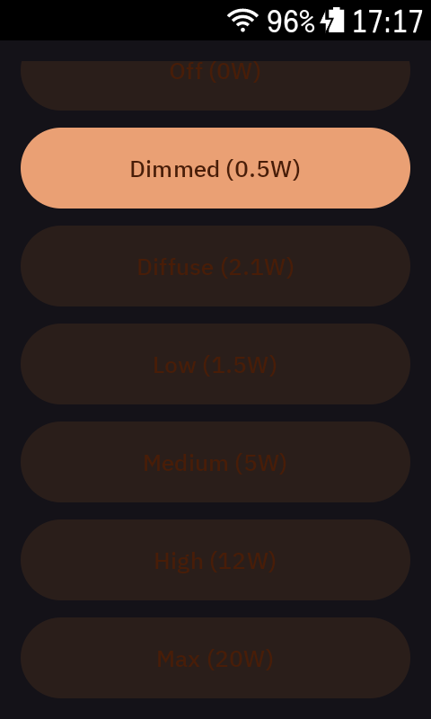

# Karoo Lupine Piko Extension

Hammerhead Karoo Extension to control a **Lupine Piko** Bluetooth light during rides.

## Features
- **In-Ride Graphical Data Fields**: View active mode, power wattage, battery voltage, and beam status directly on your Karoo ride screens.
- **Fast High-Beam / Dimmed Toggle (Dazzle Protection)**: Instantly dim the light for oncoming traffic with a single tap or Karoo button action, and return to your high-beam preset.
- **Interactive Brightness Bar**: Directly select brightness levels (`DIM`, `LOW`, `MED`, `HIGH`, `MAX`) on ride pages.
- **Cockpit Configuration App**: Customize your high-beam and dimmed presets, choose which modes cycle, and set your battery capacity for accurate telemetry.

## In-Ride Data Fields

### Lupine Light Control
Instant one-touch toggle between your high-beam preset and dimmed mode (dazzle protection), showing beam status, power wattage, and battery voltage:

  
  &nbsp;&nbsp;
  
   
  <em>Dimmed mode (0.5W) vs High Beam mode (5W)</em>

### Lupine Brightness Bar
Multi-step direct brightness control tile with active segment indicators and header telemetry:

  
  &nbsp;&nbsp;
  
   
  <em>Direct step selection across configured power levels</em>

### In-Ride Screen Preview

  
  &nbsp;&nbsp;
  
   
  <em>Full Karoo ride screens showing data fields in action</em>

## Cockpit Companion UI

  
  
  

